<!-- Every graphic is generated: python scripts/build_assets.py && python scripts/write_readme.py -->
<!-- TELEMETRY is rebuilt daily by .github/workflows/stats.yml onto the output-stats branch. -->

<picture><source media="(prefers-color-scheme: dark)" srcset="assets/hero-dark.svg"><source media="(prefers-color-scheme: light)" srcset="assets/hero-light.svg"></picture>

  <a href="https://santoshcheethirala.vercel.app"><picture><source media="(prefers-color-scheme: dark)" srcset="assets/btn-portfolio-dark.svg"><source media="(prefers-color-scheme: light)" srcset="assets/btn-portfolio-light.svg"></picture></a>
  <a href="https://www.linkedin.com/in/santoshcheethirala/"><picture><source media="(prefers-color-scheme: dark)" srcset="assets/btn-linkedin-dark.svg"><source media="(prefers-color-scheme: light)" srcset="assets/btn-linkedin-light.svg">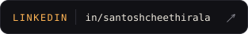</picture></a>
  <a href="https://github.com/santoshcheethiralame-dot?tab=repositories"><picture><source media="(prefers-color-scheme: dark)" srcset="assets/btn-github-dark.svg"><source media="(prefers-color-scheme: light)" srcset="assets/btn-github-light.svg">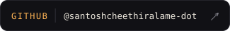</picture></a>

 

<picture><source media="(prefers-color-scheme: dark)" srcset="assets/h-about-dark.svg"><source media="(prefers-color-scheme: light)" srcset="assets/h-about-light.svg">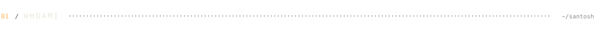</picture>

I like problems where the answer has to be <b>shown</b>, not asserted: lost writes reproduced under a linearizability checker, agent rules proven against git history, and safety audits that come with an estimate of what they missed.

 

<picture><source media="(prefers-color-scheme: dark)" srcset="assets/h-work-dark.svg"><source media="(prefers-color-scheme: light)" srcset="assets/h-work-light.svg">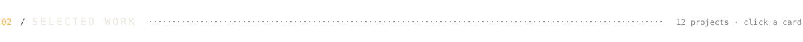</picture>

  <a href="https://github.com/santoshcheethiralame-dot/HighWater"><picture><source media="(prefers-color-scheme: dark)" srcset="assets/cards/highwater-dark.svg"><source media="(prefers-color-scheme: light)" srcset="assets/cards/highwater-light.svg">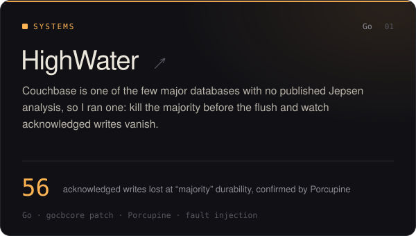</picture></a>
  <a href="https://github.com/santoshcheethiralame-dot/TESSERA"><picture><source media="(prefers-color-scheme: dark)" srcset="assets/cards/tessera-dark.svg"><source media="(prefers-color-scheme: light)" srcset="assets/cards/tessera-light.svg">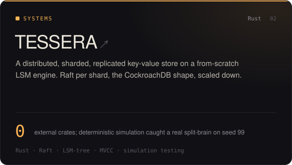</picture></a>

  <a href="https://github.com/santoshcheethiralame-dot/INJUNCT"><picture><source media="(prefers-color-scheme: dark)" srcset="assets/cards/injunct-dark.svg"><source media="(prefers-color-scheme: light)" srcset="assets/cards/injunct-light.svg">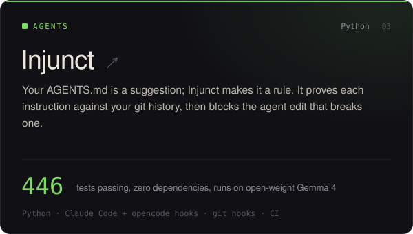</picture></a>
  <a href="https://github.com/santoshcheethiralame-dot/PRECEDENT"><picture><source media="(prefers-color-scheme: dark)" srcset="assets/cards/precedent-dark.svg"><source media="(prefers-color-scheme: light)" srcset="assets/cards/precedent-light.svg">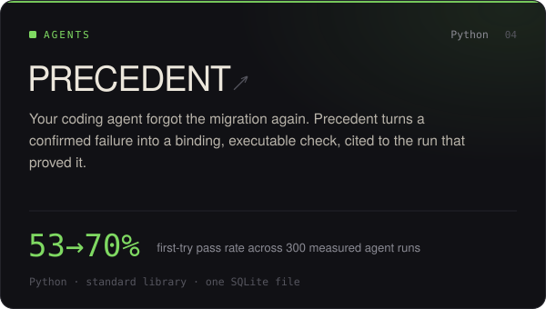</picture></a>

  <a href="https://github.com/santoshcheethiralame-dot/GlassBox"><picture><source media="(prefers-color-scheme: dark)" srcset="assets/cards/glassbox-dark.svg"><source media="(prefers-color-scheme: light)" srcset="assets/cards/glassbox-light.svg">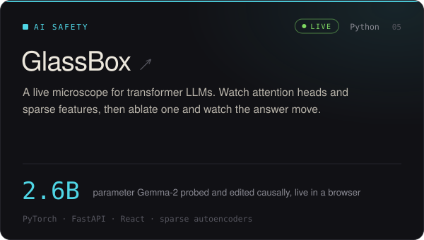</picture></a>
  <a href="https://github.com/santoshcheethiralame-dot/MissingMass"><picture><source media="(prefers-color-scheme: dark)" srcset="assets/cards/missingmass-dark.svg"><source media="(prefers-color-scheme: light)" srcset="assets/cards/missingmass-light.svg">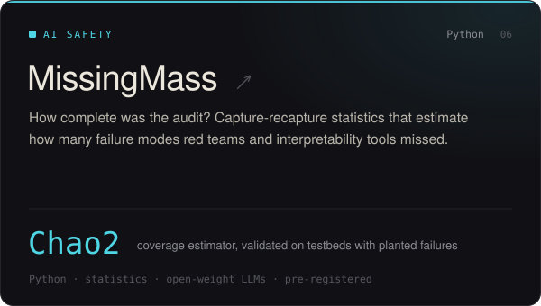</picture></a>

  <a href="https://github.com/santoshcheethiralame-dot/LIFT"><picture><source media="(prefers-color-scheme: dark)" srcset="assets/cards/lift-dark.svg"><source media="(prefers-color-scheme: light)" srcset="assets/cards/lift-light.svg">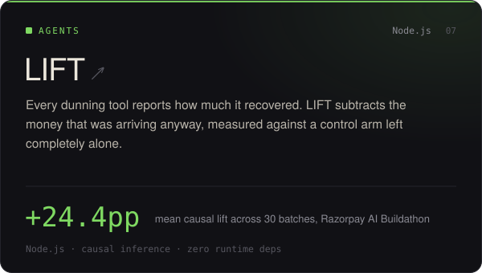</picture></a>
  <a href="https://github.com/santoshcheethiralame-dot/ConRAG"><picture><source media="(prefers-color-scheme: dark)" srcset="assets/cards/conrag-dark.svg"><source media="(prefers-color-scheme: light)" srcset="assets/cards/conrag-light.svg">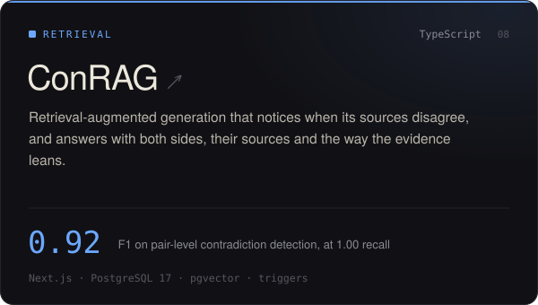</picture></a>

  <a href="https://github.com/santoshcheethiralame-dot/GRADIENT"><picture><source media="(prefers-color-scheme: dark)" srcset="assets/cards/gradient-dark.svg"><source media="(prefers-color-scheme: light)" srcset="assets/cards/gradient-light.svg">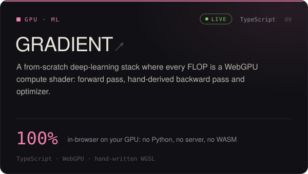</picture></a>
  <a href="https://github.com/santoshcheethiralame-dot/BAOLI"><picture><source media="(prefers-color-scheme: dark)" srcset="assets/cards/baoli-dark.svg"><source media="(prefers-color-scheme: light)" srcset="assets/cards/baoli-light.svg">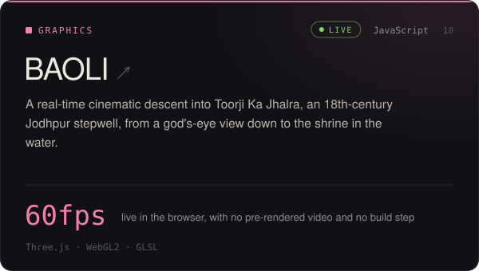</picture></a>

  <a href="https://github.com/santoshcheethiralame-dot/SMUDGE"><picture><source media="(prefers-color-scheme: dark)" srcset="assets/cards/smudge-dark.svg"><source media="(prefers-color-scheme: light)" srcset="assets/cards/smudge-light.svg">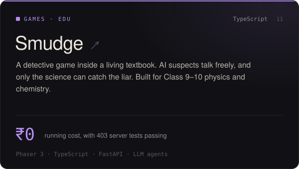</picture></a>
  <a href="https://github.com/santoshcheethiralame-dot/EMBER-BOOK"><picture><source media="(prefers-color-scheme: dark)" srcset="assets/cards/ember-dark.svg"><source media="(prefers-color-scheme: light)" srcset="assets/cards/ember-light.svg">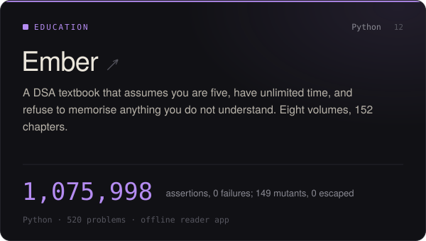</picture></a>

 

<picture><source media="(prefers-color-scheme: dark)" srcset="assets/h-more-dark.svg"><source media="(prefers-color-scheme: light)" srcset="assets/h-more-light.svg"></picture>

  <a href="https://github.com/santoshcheethiralame-dot/ShowMe"><picture><source media="(prefers-color-scheme: dark)" srcset="assets/rows/showme-dark.svg"><source media="(prefers-color-scheme: light)" srcset="assets/rows/showme-light.svg">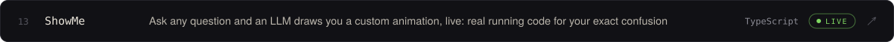</picture></a>
  <a href="https://github.com/santoshcheethiralame-dot/CallSheet"><picture><source media="(prefers-color-scheme: dark)" srcset="assets/rows/callsheet-dark.svg"><source media="(prefers-color-scheme: light)" srcset="assets/rows/callsheet-light.svg">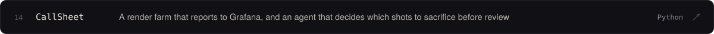</picture></a>
  <a href="https://github.com/santoshcheethiralame-dot/UNTANGLE"><picture><source media="(prefers-color-scheme: dark)" srcset="assets/rows/untangle-dark.svg"><source media="(prefers-color-scheme: light)" srcset="assets/rows/untangle-light.svg">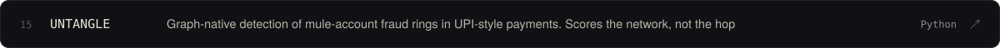</picture></a>
  <a href="https://github.com/santoshcheethiralame-dot/ATTEST"><picture><source media="(prefers-color-scheme: dark)" srcset="assets/rows/attest-dark.svg"><source media="(prefers-color-scheme: light)" srcset="assets/rows/attest-light.svg">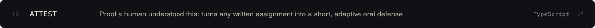</picture></a>
  <a href="https://github.com/santoshcheethiralame-dot/ATLAS"><picture><source media="(prefers-color-scheme: dark)" srcset="assets/rows/atlas-dark.svg"><source media="(prefers-color-scheme: light)" srcset="assets/rows/atlas-light.svg">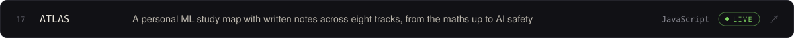</picture></a>
  <a href="https://github.com/santoshcheethiralame-dot/ORBIT"><picture><source media="(prefers-color-scheme: dark)" srcset="assets/rows/orbit-dark.svg"><source media="(prefers-color-scheme: light)" srcset="assets/rows/orbit-light.svg">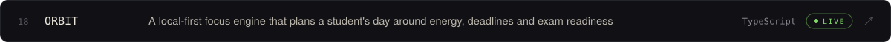</picture></a>
  <a href="https://github.com/santoshcheethiralame-dot/CRUX"><picture><source media="(prefers-color-scheme: dark)" srcset="assets/rows/crux-dark.svg"><source media="(prefers-color-scheme: light)" srcset="assets/rows/crux-light.svg">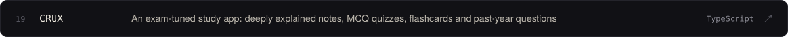</picture></a>
  <a href="https://github.com/santoshcheethiralame-dot/TERRACREST"><picture><source media="(prefers-color-scheme: dark)" srcset="assets/rows/terracrest-dark.svg"><source media="(prefers-color-scheme: light)" srcset="assets/rows/terracrest-light.svg">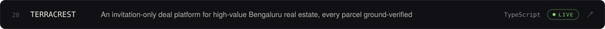</picture></a>
  <a href="https://github.com/santoshcheethiralame-dot/skills"><picture><source media="(prefers-color-scheme: dark)" srcset="assets/rows/skills-dark.svg"><source media="(prefers-color-scheme: light)" srcset="assets/rows/skills-light.svg">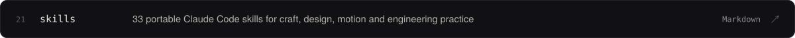</picture></a>

<b>In the lab</b> &nbsp;·&nbsp; research and works in progress, in private repos for now

 

- **DRAGNET**: distribution-free, set-valued causal attribution for RAG, using conformal prediction
- **LINEUP**: a controlled benchmark for causal chunk-role attribution in RAG
- **FORGE**: an agent that writes, safety-checks and keeps its own tools
- **HEMLOCK**: grounded discharge-medication safety review
- **CHRONOS**: a time-travel debugger for Python

 

<picture><source media="(prefers-color-scheme: dark)" srcset="assets/h-stack-dark.svg"><source media="(prefers-color-scheme: light)" srcset="assets/h-stack-light.svg">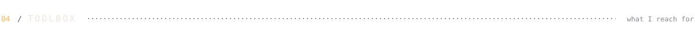</picture>

<picture><source media="(prefers-color-scheme: dark)" srcset="assets/toolbox-dark.svg"><source media="(prefers-color-scheme: light)" srcset="assets/toolbox-light.svg">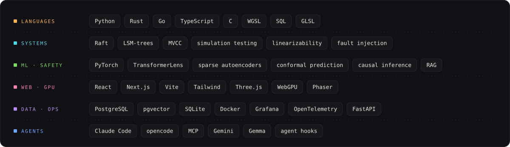</picture>

 

<picture><source media="(prefers-color-scheme: dark)" srcset="assets/h-stats-dark.svg"><source media="(prefers-color-scheme: light)" srcset="assets/h-stats-light.svg">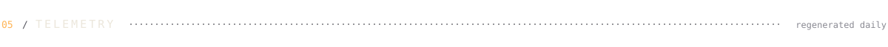</picture>

<picture><source media="(prefers-color-scheme: dark)" srcset="https://raw.githubusercontent.com/santoshcheethiralame-dot/santoshcheethiralame-dot/output-stats/stats-dark.svg"><source media="(prefers-color-scheme: light)" srcset="https://raw.githubusercontent.com/santoshcheethiralame-dot/santoshcheethiralame-dot/output-stats/stats-light.svg"></picture>

 

<picture><source media="(prefers-color-scheme: dark)" srcset="assets/h-arcade-dark.svg"><source media="(prefers-color-scheme: light)" srcset="assets/h-arcade-light.svg">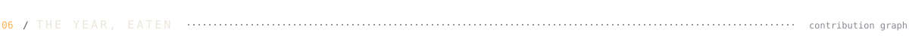</picture>

<picture><source media="(prefers-color-scheme: dark)" srcset="https://raw.githubusercontent.com/santoshcheethiralame-dot/santoshcheethiralame-dot/output/snake-dark.svg"><source media="(prefers-color-scheme: light)" srcset="https://raw.githubusercontent.com/santoshcheethiralame-dot/santoshcheethiralame-dot/output/snake.svg"></picture>

&nbsp;or watch pac-man do it

 

 

<picture><source media="(prefers-color-scheme: dark)" srcset="assets/footer-dark.svg"><source media="(prefers-color-scheme: light)" srcset="assets/footer-light.svg"></picture>

