<div align="center">

```
  █████████    █████████   ██████   █████ ███████████    ███████     █████████  █████   █████
 ███░░░░░███  ███░░░░░███ ░░██████ ░░███ ░█░░░███░░░█  ███░░░░░███  ███░░░░░███░░███   ░░███ 
░███    ░░░  ░███    ░███  ░███░███ ░███ ░   ░███  ░  ███     ░░███░███    ░░░  ░███    ░███ 
░░█████████  ░███████████  ░███░░███░███     ░███    ░███      ░███░░█████████  ░███████████ 
 ░░░░░░░░███ ░███░░░░░███  ░███ ░░██████     ░███    ░███      ░███ ░░░░░░░░███ ░███░░░░░███ 
 ███    ░███ ░███    ░███  ░███  ░░█████     ░███    ░░███     ███  ███    ░███ ░███    ░███ 
░░█████████  █████   █████ █████  ░░█████    █████    ░░░███████░  ░░█████████  █████   █████
 ░░░░░░░░░  ░░░░░   ░░░░░ ░░░░░    ░░░░░    ░░░░░       ░░░░░░░     ░░░░░░░░░  ░░░░░   ░░░░░
```

### CS @ PES University · Systems · AI Safety · Agents

[](https://santoshcheethirala.vercel.app)
[](https://github.com/santoshcheethiralame-dot)
[](https://www.linkedin.com/in/santoshcheethirala/)

</div>

I like problems where the answer has to be **shown**, not asserted: lost writes reproduced under a linearizability checker, agent rules proven against git history, safety audits that come with an estimate of what they missed.

<br>

<p align="center"></p>

## `~/projects`

### `systems/`

- **[TESSERA](https://github.com/santoshcheethiralame-dot/TESSERA)** `Rust` · a sharded, replicated key-value store on a from-scratch LSM engine. Standard library only, zero crates. Its simulator caught a real split-brain on seed 99
- **[HighWater](https://github.com/santoshcheethiralame-dot/HighWater)** `Go` · Couchbase has no published Jepsen analysis, so I ran one. It lost **56 acknowledged writes** at `majority` durability

### `agents/`

- **[INJUNCT](https://github.com/santoshcheethiralame-dot/INJUNCT)** `Python` · your AGENTS.md is a suggestion; this makes it a rule. Proves each instruction against git history, then blocks the edit that breaks it
- **[PRECEDENT](https://github.com/santoshcheethiralame-dot/PRECEDENT)** `Python` · turns one confirmed agent failure into a check that runs every time. First-try pass rate **53% → 70%** over 300 runs
- **[LIFT](https://github.com/santoshcheethiralame-dot/LIFT)** `Node.js` · revenue recovery that subtracts the money that was arriving anyway. **+24.4pp** causal lift, Razorpay AI Buildathon
- **[CallSheet](https://github.com/santoshcheethiralame-dot/CallSheet)** `Python` · a render farm reporting to Grafana, plus an agent that decides which shots to cut so the review still happens

### `ai-safety/`

- **[GlassBox](https://github.com/santoshcheethiralame-dot/GlassBox)** `Python` · a live microscope for LLMs. Watch attention heads and sparse features, then ablate one and watch the answer move · [demo](https://numero00-glassbox-interp.hf.space)
- **[MissingMass](https://github.com/santoshcheethiralame-dot/MissingMass)** `Python` · how much did the safety audit miss? Capture-recapture statistics for red teams and interpretability tools

### `data/`

- **[ConRAG](https://github.com/santoshcheethiralame-dot/ConRAG)** `TypeScript` · RAG that notices when its sources disagree and answers with both sides. **0.92 F1** on contradictions
- **[UNTANGLE](https://github.com/santoshcheethiralame-dot/UNTANGLE)** `Python` · finds UPI mule-account rings by scoring the payment graph, not single transactions

### `gpu/`

- **[GRADIENT](https://github.com/santoshcheethiralame-dot/GRADIENT)** `TypeScript` · neural nets trained entirely in WebGPU compute shaders, in a browser tab · [demo](https://santoshcheethiralame-dot.github.io/GRADIENT/)
- **[BAOLI](https://github.com/santoshcheethiralame-dot/BAOLI)** `JavaScript` · a real-time 3D descent into an 18th-century Jodhpur stepwell, 60fps, no video · [demo](https://baoli-peach.vercel.app)
- **[ShowMe](https://github.com/santoshcheethiralame-dot/ShowMe)** `TypeScript` · ask anything and an LLM draws you a custom animation, live · [demo](https://showme-sandy.vercel.app)

### `learning/`

- **[EMBER-BOOK](https://github.com/santoshcheethiralame-dot/EMBER-BOOK)** `Python` · a DSA textbook for people who refuse to memorise. 8 volumes, 520 problems, **1,075,998 assertions, 0 failures**
- **[SMUDGE](https://github.com/santoshcheethiralame-dot/SMUDGE)** `TypeScript` · a detective game where AI suspects lie and only the physics can catch them
- **[ATTEST](https://github.com/santoshcheethiralame-dot/ATTEST)** `TypeScript` · proof a human understood this: turns an essay into a short oral defense
- **[ATLAS](https://github.com/santoshcheethiralame-dot/ATLAS)** `JavaScript` · my ML study map, from the maths up to AI safety · [demo](https://atlas-eight-azure.vercel.app)
- **[ORBIT](https://github.com/santoshcheethiralame-dot/ORBIT)** `TypeScript` · local-first day planner built around energy, deadlines and exams · [demo](https://orbit-virid-gamma.vercel.app)
- **[CRUX](https://github.com/santoshcheethiralame-dot/CRUX)** `TypeScript` · exam-tuned notes, MCQs, flashcards and past papers

### `misc/`

- **[TERRACREST](https://github.com/santoshcheethiralame-dot/TERRACREST)** `TypeScript` · invite-only platform for verified Bengaluru real estate · [demo](https://terracrest.vercel.app)
- **[skills](https://github.com/santoshcheethiralame-dot/skills)** `Markdown` · 33 portable Claude Code skills

**also cooking, private for now:** DRAGNET · LINEUP · FORGE · HEMLOCK · CHRONOS

## `git diff now.md`

```diff
- reading interpretability papers
+ writing one: MissingMass, arXiv preprint aimed at Dec 2026
- trusting "majority" durability
+ 56 acknowledged writes later: persistToMajority
- AGENTS.md as a polite suggestion
+ AGENTS.md as a pre-commit hook
```

## `cat src/main.rs`

```rust
fn main() {
    let mut me = Santosh::boot();          // cse '28, pes university

    loop {
        let thing = me.build();
        let bugs  = me.break_it(&thing);   // the fun part
        assert!(bugs.iter().all(|b| b.reproduces()));   // or it didn't happen
        me.write_readme(&thing);           // longer than the code. always.
        me.coffee += 1;                    // filter. non-negotiable.
    }
}
```

## `./telemetry --since 1y`

<!-- telemetry:start -->
```text
  warming up... the first run fills this in after the next push to main.
```
<!-- telemetry:end -->

## `snake --eat ~/.contributions`

<picture>
  <source media="(prefers-color-scheme: dark)" srcset="https://raw.githubusercontent.com/santoshcheethiralame-dot/santoshcheethiralame-dot/output/snake-dark.svg">
  <source media="(prefers-color-scheme: light)" srcset="https://raw.githubusercontent.com/santoshcheethiralame-dot/santoshcheethiralame-dot/output/snake.svg">
  
</picture>

<details>
<summary>or watch pac-man do it</summary>
<br>

</details>

<br>

<p align="center"><code>santosh@github:~$ exit</code></p>
