<!-- the coloured bits are SVGs from scripts/build.py; everything else is plain text, edit away -->

<picture><source media="(prefers-color-scheme: dark)" srcset="assets/banner-dark.svg"><source media="(prefers-color-scheme: light)" srcset="assets/banner-light.svg"></picture>

<p><a href="https://github.com/santoshcheethiralame-dot"><picture><source media="(prefers-color-scheme: dark)" srcset="assets/bar/session-dark.svg"><source media="(prefers-color-scheme: light)" srcset="assets/bar/session-light.svg"></picture></a><a href="https://santoshcheethirala.vercel.app"><picture><source media="(prefers-color-scheme: dark)" srcset="assets/bar/portfolio-dark.svg"><source media="(prefers-color-scheme: light)" srcset="assets/bar/portfolio-light.svg"></picture></a><a href="https://www.linkedin.com/in/santoshcheethirala/"><picture><source media="(prefers-color-scheme: dark)" srcset="assets/bar/linkedin-dark.svg"><source media="(prefers-color-scheme: light)" srcset="assets/bar/linkedin-light.svg"></picture></a><a href="https://santoshcheethirala.vercel.app/resume"><picture><source media="(prefers-color-scheme: dark)" srcset="assets/bar/resume-dark.svg"><source media="(prefers-color-scheme: light)" srcset="assets/bar/resume-light.svg"></picture></a><a href="mailto:santoshcheethirala.me@gmail.com"><picture><source media="(prefers-color-scheme: dark)" srcset="assets/bar/email-dark.svg"><source media="(prefers-color-scheme: light)" srcset="assets/bar/email-light.svg"></picture></a></p>

<br>

<picture><source media="(prefers-color-scheme: dark)" srcset="assets/prompt/about-dark.svg"><source media="(prefers-color-scheme: light)" srcset="assets/prompt/about-light.svg"></picture>

```python
class Santosh(Undergrad):
    """cares less about whether a system works than about why it fails."""

    home     = "Bengaluru, India"
    studying = "CSE @ PES University, class of '28"
    now      = "interning @ PESU I-Labs · open to summer 2027"
    research = "tracing RAG errors back to the passages that caused them"

    stack = {
        "systems": ["Rust", "Go", "C", "Raft", "LSM-trees"],
        "ml":      ["PyTorch", "TransformerLens", "sparse autoencoders"],
        "web/gpu": ["TypeScript", "React", "Three.js", "WebGPU", "WGSL"],
    }

    def offline(self):
        yield "10m air rifle, national level"
        yield "filter coffee, non-negotiable"
```

<br>

<picture><source media="(prefers-color-scheme: dark)" srcset="assets/prompt/projects-dark.svg"><source media="(prefers-color-scheme: light)" srcset="assets/prompt/projects-light.svg"></picture>

### `systems/`

- **[TESSERA](https://github.com/santoshcheethiralame-dot/TESSERA)** `Rust` · a sharded, replicated key-value store on a from-scratch LSM engine. Standard library only, zero crates. Its simulator caught a real split-brain on seed 99
- **[HighWater](https://github.com/santoshcheethiralame-dot/HighWater)** `Go` · Couchbase has no published Jepsen analysis, so I ran one. It lost **56 acknowledged writes** at `majority` durability

### `agents/`

- **[INJUNCT](https://github.com/santoshcheethiralame-dot/INJUNCT)** `Python` · your AGENTS.md is a suggestion; this makes it a rule. Proves each instruction against git history, then blocks the edit that breaks it
- **[PRECEDENT](https://github.com/santoshcheethiralame-dot/PRECEDENT)** `Python` · turns one confirmed agent failure into a check that runs every time. First-try pass rate **53% → 70%** over 300 runs
- **[LIFT](https://github.com/santoshcheethiralame-dot/LIFT)** `Node.js` · revenue recovery that subtracts the money that was arriving anyway. **+24.4pp** causal lift, Razorpay AI Buildathon
- **[CallSheet](https://github.com/santoshcheethiralame-dot/CallSheet)** `Python` · a render farm reporting to Grafana, plus an agent that decides which shots to cut so the review still happens

### `ai-safety/`

- **[GlassBox](https://github.com/santoshcheethiralame-dot/GlassBox)** `Python` · a live microscope for LLMs. Watch attention heads and sparse features, then ablate one and watch the answer move · [demo](https://numero00-glassbox-interp.hf.space)
- **[MissingMass](https://github.com/santoshcheethiralame-dot/MissingMass)** `Python` · how much did the safety audit miss? Capture-recapture statistics for red teams and interpretability tools

### `data/`

- **[ConRAG](https://github.com/santoshcheethiralame-dot/ConRAG)** `TypeScript` · RAG that notices when its sources disagree and answers with both sides. **0.92 F1** on contradictions
- **[UNTANGLE](https://github.com/santoshcheethiralame-dot/UNTANGLE)** `Python` · finds UPI mule-account rings by scoring the payment graph, not single transactions

### `gpu/`

- **[GRADIENT](https://github.com/santoshcheethiralame-dot/GRADIENT)** `TypeScript` · neural nets trained entirely in WebGPU compute shaders, in a browser tab · [demo](https://santoshcheethiralame-dot.github.io/GRADIENT/)
- **[BAOLI](https://github.com/santoshcheethiralame-dot/BAOLI)** `JavaScript` · a real-time 3D descent into an 18th-century Jodhpur stepwell, 60fps, no video · [demo](https://baoli-peach.vercel.app)
- **[ShowMe](https://github.com/santoshcheethiralame-dot/ShowMe)** `TypeScript` · ask anything and an LLM draws you a custom animation, live · [demo](https://showme-sandy.vercel.app)

### `learning/`

- **[EMBER-BOOK](https://github.com/santoshcheethiralame-dot/EMBER-BOOK)** `Python` · a DSA textbook for people who refuse to memorise. 8 volumes, 520 problems, **1,075,998 assertions, 0 failures**
- **[SMUDGE](https://github.com/santoshcheethiralame-dot/SMUDGE)** `TypeScript` · a detective game where AI suspects lie and only the physics can catch them
- **[ATTEST](https://github.com/santoshcheethiralame-dot/ATTEST)** `TypeScript` · proof a human understood this: turns an essay into a short oral defense
- **[ATLAS](https://github.com/santoshcheethiralame-dot/ATLAS)** `JavaScript` · my ML study map, from the maths up to AI safety · [demo](https://atlas-eight-azure.vercel.app)
- **[ORBIT](https://github.com/santoshcheethiralame-dot/ORBIT)** `TypeScript` · local-first day planner built around energy, deadlines and exams · [demo](https://orbit-virid-gamma.vercel.app)
- **[CRUX](https://github.com/santoshcheethiralame-dot/CRUX)** `TypeScript` · exam-tuned notes, MCQs, flashcards and past papers

### `misc/`

- **[TERRACREST](https://github.com/santoshcheethiralame-dot/TERRACREST)** `TypeScript` · invite-only platform for verified Bengaluru real estate · [demo](https://terracrest.vercel.app)
- **[skills](https://github.com/santoshcheethiralame-dot/skills)** `Markdown` · 33 portable Claude Code skills

**also cooking, private for now:** DRAGNET · LINEUP · FORGE · HEMLOCK · CHRONOS

<br>

<picture><source media="(prefers-color-scheme: dark)" srcset="assets/prompt/now-dark.svg"><source media="(prefers-color-scheme: light)" srcset="assets/prompt/now-light.svg"></picture>

```diff
@@ now.md @@
- looking for a research lab that would have me
+ interning @ PESU I-Labs, first author on a RAG attribution benchmark
- reading interpretability papers
+ writing one: MissingMass, arXiv preprint aimed at Dec 2026
- trusting "majority" durability
+ 56 acknowledged writes later: persistToMajority
- AGENTS.md as a polite suggestion
+ AGENTS.md as a pre-commit hook
```

<br>

<picture><source media="(prefers-color-scheme: dark)" srcset="assets/prompt/resume-dark.svg"><source media="(prefers-color-scheme: light)" srcset="assets/prompt/resume-light.svg"></picture>

<p>
<a href="https://santoshcheethirala.vercel.app/resumes/Cheethirala_Resume_SWE_Backend.pdf"><picture><source media="(prefers-color-scheme: dark)" srcset="assets/resume/swe-backend-dark.svg"><source media="(prefers-color-scheme: light)" srcset="assets/resume/swe-backend-light.svg"></picture></a><br>
<a href="https://santoshcheethirala.vercel.app/resumes/Cheethirala_Resume_ML_Research.pdf"><picture><source media="(prefers-color-scheme: dark)" srcset="assets/resume/ml-research-dark.svg"><source media="(prefers-color-scheme: light)" srcset="assets/resume/ml-research-light.svg"></picture></a><br>
<a href="https://santoshcheethirala.vercel.app/resumes/Cheethirala_Resume_Systems_Infra.pdf"><picture><source media="(prefers-color-scheme: dark)" srcset="assets/resume/systems-infra-dark.svg"><source media="(prefers-color-scheme: light)" srcset="assets/resume/systems-infra-light.svg"></picture></a><br>
<a href="https://santoshcheethirala.vercel.app/resumes/Cheethirala_Resume_Fintech_Data.pdf"><picture><source media="(prefers-color-scheme: dark)" srcset="assets/resume/fintech-data-dark.svg"><source media="(prefers-color-scheme: light)" srcset="assets/resume/fintech-data-light.svg"></picture></a><br>
<a href="https://santoshcheethirala.vercel.app/resumes/Cheethirala_Resume_SDET_Quality.pdf"><picture><source media="(prefers-color-scheme: dark)" srcset="assets/resume/sdet-quality-dark.svg"><source media="(prefers-color-scheme: light)" srcset="assets/resume/sdet-quality-light.svg"></picture></a><br>
<a href="https://santoshcheethirala.vercel.app/resumes/Cheethirala_Resume_Security.pdf"><picture><source media="(prefers-color-scheme: dark)" srcset="assets/resume/security-dark.svg"><source media="(prefers-color-scheme: light)" srcset="assets/resume/security-light.svg"></picture></a><br>
</p>

<sub>six editions of one résumé, each leading with the work that fits the role. not sure which? <code>swe-backend</code> is the general read, or <a href="https://santoshcheethirala.vercel.app/resume">pick on the site</a>.</sub>

<br>

<picture><source media="(prefers-color-scheme: dark)" srcset="assets/prompt/loop-dark.svg"><source media="(prefers-color-scheme: light)" srcset="assets/prompt/loop-light.svg"></picture>

```rust
// std only. no crates were harmed.
fn main() {
    let mut me = Santosh::boot();            // cse '28, pes university

    loop {
        let thing = me.build();
        let bugs  = me.break_it(&thing);     // the fun part
        assert!(bugs.iter().all(|b| b.reproduces()));   // or it didn't happen
        me.write_readme(&thing);             // longer than the code. always.
        me.coffee += 1;                      // filter. non-negotiable.
    }
}
```

<br>

<picture><source media="(prefers-color-scheme: dark)" srcset="assets/prompt/telemetry-dark.svg"><source media="(prefers-color-scheme: light)" srcset="assets/prompt/telemetry-light.svg"></picture>

<!-- telemetry:start -->
```yaml
# warming up: the first run fills this in after the next push to main
```
<!-- telemetry:end -->

<br>

<picture><source media="(prefers-color-scheme: dark)" srcset="assets/prompt/snake-dark.svg"><source media="(prefers-color-scheme: light)" srcset="assets/prompt/snake-light.svg"></picture>

<picture><source media="(prefers-color-scheme: dark)" srcset="https://raw.githubusercontent.com/santoshcheethiralame-dot/santoshcheethiralame-dot/output/snake-dark.svg"><source media="(prefers-color-scheme: light)" srcset="https://raw.githubusercontent.com/santoshcheethiralame-dot/santoshcheethiralame-dot/output/snake.svg"></picture>

<details>
<summary><code>~ $ pacman --eat ~/.contributions</code></summary>
<br>

</details>

<br>

<picture><source media="(prefers-color-scheme: dark)" srcset="assets/prompt/exit-dark.svg"><source media="(prefers-color-scheme: light)" srcset="assets/prompt/exit-light.svg"></picture>

```text
logout

[Process completed]
```

<p align="right"></p>
